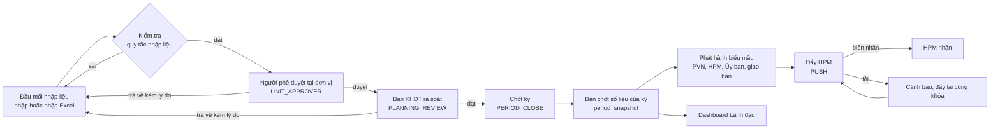
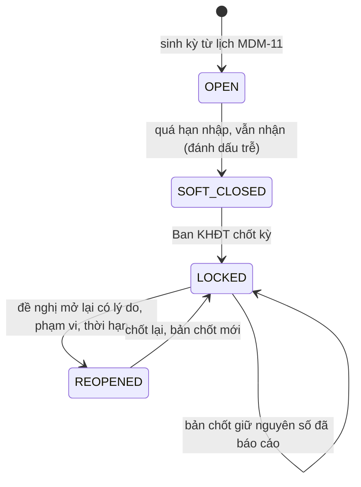

# 02. Quy trình quản lý To-Be trên phần mềm

Giai đoạn 2, sản phẩm 2 của mục II.5. Dòng ma trận: GD.2, SP.02. Mã yêu cầu: QT.01, QT.02 (và CN.02, CN.03, CN.04, TH.01, HT.03, HT.06 ở các điểm giao). PVFCCo phê duyệt: có (quy trình To-Be).

Nguồn: Hồ sơ kỹ thuật mục II.3 (QT.01, QT.02) và kết luận Biên bản họp 43/BBH-KHĐT; `docs/adm-approval-workflow.md`; `packages/kernel/src/dis-report-workflow.ts` (quy trình duyệt báo cáo có bước: `UNIT_APPROVER`, `PLANNING_REVIEW`, `PERIOD_CLOSE`, `PUSH`); `docs/dis-report-decision.md`; `docs/dis-snapshot.md`; `docs/hpm-ebs-connectors.md`; `Design/MACHVON_Design/01_Documents/05_modules/` (các tệp ADM.md, DIS.md, DIR.md, HPM.md, EBS.md). Điều đã có trong mã ghi "Có"; điều thuộc làn đang làm ghi tên làn.

Trạng thái tệp: KHUNG quy trình dựng từ cơ chế đã có; hạn từng bước, người giữ vai trò và các điểm `[khách điền]` do Tổ chuẩn hóa dữ liệu quyết định trước khi trình phê duyệt.

---

## 1. Nguyên tắc

1. Mỗi số liệu nhập một lần tại đầu mối; mọi biểu mẫu, dashboard và gói đẩy HPM đọc cùng bản số liệu đã chốt (quyết định kỹ thuật R21; làn ENT-3a dựng đường đọc này).
2. Người lập không phải người duyệt: hệ thống từ chối người nhập tự duyệt (`SELF_APPROVAL_DENIED`), kiểm trên tài khoản chứ không trên vai trò (`docs/adm-approval-workflow.md`).
3. Quyết định duyệt cần xác thực bước hai (aal2 trong 15 phút).
4. Sai sót trả về người nhập kèm lý do tối thiểu 10 ký tự; không sửa im lặng.
5. Kỳ đã chốt không đổi; mở lại phải có lý do, phạm vi, thời hạn và người duyệt khác người đề nghị (BR-R11 của BRD).
6. Quy trình là dữ liệu cấu hình (quy tắc `APPROVAL_WORKFLOW_DEFINITION`, mã `REPORT_ACCEPT`, có phiên bản, người duyệt phiên bản khác người soạn), quản trị đổi được khi quy định đổi (QT.01).

## 2. Tổng quan luồng



Phiên bản chữ cho nơi không vẽ được sơ đồ:

```
Đầu mối nhập (1 người/đầu mối)
   |  kiểm tra tự động: lũy kế <= tổng mức đầu tư; vốn chủ sở hữu + vốn vay = tổng;
   |  kỳ chưa chốt; trường bắt buộc            (IND-02, DIS)
   v
Người phê duyệt đơn vị (1 người/đầu mối)  --trả về + lý do--> Đầu mối nhập
   v
Ban KHĐT rà soát, kiểm tra                 --trả về + lý do--> Đầu mối nhập
   v
Chốt kỳ (khóa số liệu)  --> Bản chốt (băm SHA-256, giữ đúng số đã báo cáo)
   v
Phát hành biểu mẫu (Excel đúng mẫu, Word thuyết minh, PDF) --> gửi nơi nhận
   v
Đẩy HPM theo khóa (tổ chức, biểu mẫu, kỳ, phiên bản) --> biên nhận
```

## 3. Các bước, vai trò và điều kiện chuyển bước (QT.01)

Cột "Trong hệ thống" cho biết cơ chế đã có hay làn đang làm. Cột "Hạn" do Tổ chuẩn hóa dữ liệu quyết định; hệ thống đặt hạn theo giờ làm việc trên lịch làm việc của tenant (ADM-07) và nhắc ở 80% hạn.

| Bước | Vai trò | Điều kiện vào | Điều kiện ra | Trả về | Hạn | Trong hệ thống |
|---|---|---|---|---|---|---|
| 1. Nhập liệu | Người nhập đầu mối | Kỳ đang mở (OPEN) hoặc kỳ mở lại đã duyệt | Qua quy tắc nhập liệu BLOCK; gửi | không áp dụng | [khách điền: ngày chốt nhập] | Có: DIS-03 đến DIS-06, IND-02, nhập Excel (DIS-10, IND-03) |
| 2. Duyệt đơn vị | Người phê duyệt đơn vị (`UNIT_APPROVER`) | Báo cáo đã gửi; không là người lập | Duyệt | Có, kèm lý do 10 ký tự | [khách điền] (mặc định hiện có 24 giờ làm việc) | Có: chế độ `STAGED` của `REPORT_ACCEPT` |
| 3. Ban KHĐT rà soát | Ban KHĐT (`PLANNING_REVIEW`) | Bước 2 đã duyệt | Duyệt | Có, về đầu mối | [khách điền] | Có |
| 4. Chốt kỳ | Ban KHĐT (`PERIOD_CLOSE`) | Mọi đầu mối đã qua bước 3 hoặc có giải trình; kiểm tổng chéo đạt (DIS-26) | Dựng và đóng băng bản chốt, kỳ sang LOCKED | Không; mở lại bằng quy trình riêng (mục 5) | [khách điền] | Có (DIS-21); bản chốt enterprise: ENT-3a |
| 5. Đẩy HPM | Ban KHĐT hoặc người được giao (`PUSH`) | Biểu mẫu đã phát hành từ bản chốt | HPM có biên nhận | Đẩy lại cùng khóa | [khách điền] | Một phần: bước hiện là bước người; gọi đẩy tự động và trạng thái chờ biên nhận: ENT-3c |

Cách người nhận việc được chọn: ma trận thẩm quyền (ADM-15, `DOA`), vai trò trong đơn vị (`ROLE_IN_UNIT`) hoặc chỉ định (`SPECIFIC`). Mỗi bước có `min_approvals`, hạn theo giờ làm việc và hành động khi quá hạn (`REMIND`, `ESCALATE`, `EXPIRE`). Người được ủy quyền quyết định thay được và việc đó được ghi (`on_behalf_of_id`, ADM-04, ADM-25).

Phạm vi quy trình hiện nay: báo cáo tuần/tháng của DIS. Mở rộng cho lô số liệu vốn (FND) và nhập chỉ tiêu (IND): ENT-3c.

## 4. Cảnh báo sai sót (BBH 43/BBH-KHĐT)

| Thời điểm | Nội dung cảnh báo | Gửi tới | Cơ chế |
|---|---|---|---|
| Lúc nhập | Vi phạm quy tắc: lũy kế vượt tổng mức đầu tư, vốn chủ sở hữu + vốn vay khác tổng, kỳ đã chốt, thiếu trường bắt buộc | Người nhập, ngay trên màn hình | `IND_ENTRY_RULE_VIOLATED` (BLOCK) hoặc cảnh báo (WARN) |
| Khi trả về | Lý do trả về | Người nhập và người phê duyệt đơn vị | Quyết định `return`; thông báo qua NOT |
| Quá hạn bước | Nhắc ở 80% hạn; hành động khi quá hạn | Người giữ việc, cấp trên nếu `ESCALATE` | SLA của nhiệm vụ duyệt (ADM-13); kênh email/Teams: ENT-4c |
| Sau chốt | Chênh lệch giải ngân so với EBS | Chủ khoản chênh (không là người nạp) | EBS-02 |
| Đẩy HPM lỗi hoặc quá hạn biên nhận | `HPM_PUSH_FAILED`, `HPM_PUSH_STALE` | Quản trị tích hợp | Trung tâm cảnh báo |

## 5. Chốt kỳ, mở lại kỳ và điều chỉnh (QT.02)



- Kỳ: OPEN, SOFT_CLOSED, LOCKED (BR-R11). Lệnh `softCloseReportingPeriod`, `lockReportingPeriod`, `requestPeriodReopen`, `decidePeriodReopen`; người duyệt mở lại khác người đề nghị; mở lại giới hạn trong danh sách dự án và có hạn (DIS-22).
- Bản chốt `PERIOD_CLOSE` đã đóng băng không bao giờ bị thay; số điều chỉnh sau đó là bản chốt mới sau khi mở lại (`docs/fnd-funding-model.md`, bất biến I6).
- Điều chỉnh sau khi đã đẩy HPM (TH.01): hai cách theo hồ sơ kỹ thuật, ghi đè kỳ hoặc điều chỉnh ở kỳ sau. Ghi đè đã có (kỳ mở lại và đính chính do hai người đề nghị và duyệt, HPM-02). "Ở kỳ sau": ENT-3c. Quy tắc nào dùng cho trường hợp nào: `[khách điền: Ban KHĐT quyết định]`.
- Điều chỉnh kế hoạch trong năm: sửa đổi phiên bản kế hoạch có căn cứ văn bản (CAP-07, ST-CAP-004).

## 6. Lịch kỳ và hạn (QT.02)

| Loại kỳ | Hiện có | Cần cấu hình | Làn |
|---|---|---|---|
| Tháng | Lịch kỳ từ MDM-11; hạn nhập cố định ngày 5 tháng sau | Hạn từng bước | ENT-4c |
| Quý | Chưa có lịch riêng | Lịch quý, hạn từng bước | ENT-4c |
| Năm | Năm kế hoạch trong CAP | Lịch năm | ENT-4c |
| Giao ban | Cuộc giao ban ghi ở DIR-01 | Lịch giao ban và hạn nộp thuyết minh | ENT-4c |

Theo dõi trạng thái nhập của từng đầu mối: DIS-15 (tiến độ nộp). Mốc thời điểm chốt theo hồ sơ: số liệu ước đến cuối kỳ chốt ngày 10 đến 15; nhập lại HPM ngày 15 đến 18; giao ban giữa tháng sau. `[khách điền: hạn To-Be của từng loại kỳ]`.

## 7. Chỉ đạo giao ban (CN.03) trong quy trình

```
Giao ban đầu tư (DIR-01)  -->  Chỉ đạo theo dự án hoặc đơn vị, đơn vị thực hiện, hạn (DIR-02)
    -->  Theo dõi (DIR-03): quá hạn lên đầu, theo đơn vị
    -->  Ghi tiến độ, đề nghị gia hạn, đóng kèm bằng chứng (DIR-04)
    -->  Tổng hợp chỉ đạo của kỳ làm đầu vào thuyết minh kỳ sau (DIR-05)
```

Có trong mã: DIR-01 đến DIR-06, thao tác `getDirectivesForReport`. Nối kết quả vào thuyết minh của biểu mẫu enterprise: ENT-3b.

## 8. Ma trận trách nhiệm (RACI) đề xuất

R: làm, A: chịu trách nhiệm cuối, C: góp ý, I: được báo.

| Hoạt động | Đầu mối nhập | Người duyệt đơn vị | Ban KHĐT | Ban TCKT | Lãnh đạo | Ban CĐS&CNTT |
|---|---|---|---|---|---|---|
| Nhập số liệu kỳ | R, A | I | I | C (số giải ngân) | | |
| Duyệt tại đơn vị | C | R, A | I | | | |
| Rà soát và chốt kỳ | C | C | R, A | C | I | |
| Mở lại kỳ | C | C | R | | A (theo thẩm quyền) | I |
| Đẩy HPM | | | R, A | | I | C |
| Đối chiếu EBS | | | A | R | | I |
| Chỉ đạo giao ban | R (đơn vị thực hiện) | | R (theo dõi) | | A | |
| Cấu hình quy trình, danh mục | | | A | | | R |

Cột này là đề xuất; `[khách điền: xác nhận RACI]`.

## 9. Điểm cần PVFCCo quyết định để phê duyệt To-Be

1. Hạn từng bước cho tháng, quý, năm, giao ban.
2. Bước 3 là một đơn vị hay nhiều người (Ban KHĐT có bao nhiêu người rà soát mỗi đầu mối).
3. Quy tắc chọn "ghi đè kỳ" hay "điều chỉnh ở kỳ sau" sau khi đã đẩy HPM.
4. Có tự động đẩy HPM ngay sau chốt hay người của Ban KHĐT bấm đẩy (PX-03 chi phối).
5. Ngưỡng cho phép chênh lệch với EBS và so sánh chéo giữa các báo cáo (đề xuất chặn phát hành khi lệch không có giải trình).

Lịch sử sửa: v0.1 khung ngày 2026-11-09.
