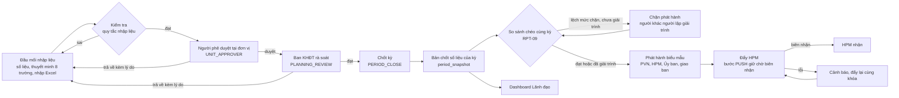
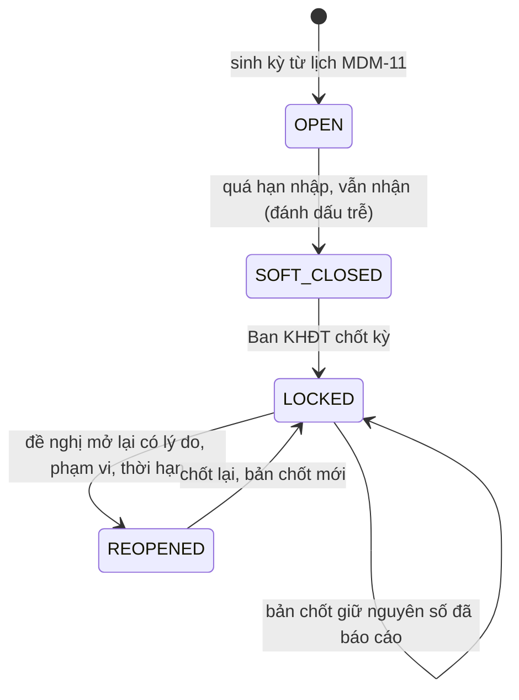

# 02. Quy trình quản lý To-Be trên phần mềm

Giai đoạn 2, sản phẩm 2 của mục II.5. Dòng ma trận: GD.2, SP.02. Mã yêu cầu: QT.01, QT.02 (và CN.02, CN.03, CN.04, TH.01, HT.03, HT.06 ở các điểm giao). PVFCCo phê duyệt: có (quy trình To-Be).

Nguồn: Hồ sơ kỹ thuật mục II.3 (QT.01, QT.02) và kết luận Biên bản họp 43/BBH-KHĐT; `docs/adm-approval-workflow.md`; `packages/kernel/src/dis-report-workflow.ts` (quy trình duyệt báo cáo có bước: `UNIT_APPROVER`, `PLANNING_REVIEW`, `PERIOD_CLOSE`, `PUSH`); `docs/dis-report-decision.md`; `docs/dis-snapshot.md`; `docs/hpm-ebs-connectors.md`; `packages/kernel/src/staged-approval.ts` (ba chủ thể của quy trình nhiều bước); `packages/kernel/src/reporting-schedule.ts` (lịch kỳ và hạn từng bước); `docs/integration/hpm-proposal.md` (quy tắc lỗi, thử lại, điều chỉnh sau khi đẩy); `docs/report-engine.md` (so sánh chéo trước phát hành); `Design/MACHVON_Design/01_Documents/05_modules/` (các tệp ADM.md, DIS.md, DIR.md, HPM.md, EBS.md, ORG.md, RPT.md). Điều đã có trong mã ghi "Có"; điều còn thiếu ghi rõ thiếu gì; điều chờ khách ghi mã PX-nn.

Trạng thái tệp (v0.2, 2026-11-12): đã điền từ thiết kế và mã nguồn đến ngày 2026-11-12, sau khi các làn ENT-3a đến ENT-4e gộp vào nhánh chính. Các bước, vai trò, điều kiện chuyển bước, tham số hạn (quy tắc `REPORTING_SCHEDULE`), cảnh báo và RACI đề xuất đã có giá trị cụ thể và đều là giá trị khởi đầu của nhà cung cấp, gắn UNVERIFIED; việc chốt hạn từng bước, người giữ vai trò (PX-05) và các điểm `[khách điền]` do Tổ chuẩn hóa dữ liệu quyết định trước khi trình phê duyệt (PX-12).

---

## 1. Nguyên tắc

1. Mỗi số liệu nhập một lần tại đầu mối; mọi biểu mẫu, dashboard và gói đẩy HPM đọc cùng bản số liệu đã chốt (quyết định kỹ thuật R21). Đường đọc này đã có: bản chốt doanh nghiệp `period_snapshot` (băm schema 2; dựng ở DIS-32, chốt ở DIS-33) và bộ đọc duy nhất `EnterpriseFigureReader` trong `packages/kernel/src/enterprise-snapshot.ts`; sáu biểu mẫu, bảng lãnh đạo (HOME-09, BAN-01) và gói đẩy HPM đều đọc qua bộ đọc đó.
2. Người lập không phải người duyệt: hệ thống từ chối người nhập tự duyệt (`SELF_APPROVAL_DENIED`), kiểm trên tài khoản chứ không trên vai trò (`docs/adm-approval-workflow.md`).
3. Quyết định duyệt cần xác thực bước hai (aal2 trong 15 phút).
4. Sai sót trả về người nhập kèm lý do tối thiểu 10 ký tự; không sửa im lặng.
5. Kỳ đã chốt không đổi; mở lại phải có lý do, phạm vi, thời hạn và người duyệt khác người đề nghị (BR-R11 của BRD).
6. Quy trình là dữ liệu cấu hình (quy tắc `APPROVAL_WORKFLOW_DEFINITION`, mã `REPORT_ACCEPT`, có phiên bản, người duyệt phiên bản khác người soạn), quản trị đổi được khi quy định đổi (QT.01). Cùng cơ chế chạy cho ba chủ thể: báo cáo DIS, lô số liệu vốn (FND) và lô chỉ tiêu (IND), mỗi chủ thể một mã quy tắc (mục 3).

## 2. Tổng quan luồng



Phiên bản chữ cho nơi không vẽ được sơ đồ:

```
Đầu mối nhập (1 người/đầu mối)
   |  kiểm tra tự động: lũy kế <= tổng mức đầu tư; vốn chủ sở hữu + vốn vay = tổng;
   |  kỳ chưa chốt; trường bắt buộc            (IND-02, DIS)
   v
Người phê duyệt đơn vị (1 người/đầu mối)  --trả về + lý do--> Đầu mối nhập
   v
Ban KHĐT rà soát, kiểm tra                 --trả về + lý do--> Đầu mối nhập
   v
Chốt kỳ (khóa số liệu)  --> Bản chốt (băm SHA-256, giữ đúng số đã báo cáo)
   v
So sánh chéo cùng kỳ giữa các báo cáo (RPT-09): lệch mức chặn thì chặn phát hành cho tới khi có giải trình
   v
Phát hành biểu mẫu (Excel đúng mẫu, Word thuyết minh, PDF) --> gửi nơi nhận
   v
Đẩy HPM theo khóa (tổ chức, biểu mẫu, kỳ, phiên bản) --> biên nhận
```

## 3. Các bước, vai trò và điều kiện chuyển bước (QT.01)

Cột "Trong hệ thống" cho biết cơ chế đã có và màn hình tương ứng. Cột "Hạn" do Tổ chuẩn hóa dữ liệu quyết định; giá trị ghi sau dấu chấm phẩy là mặc định khởi đầu của nhà cung cấp (giờ làm việc của nhiệm vụ duyệt trong gói mẫu ORG-01; số ngày sau cuối kỳ của lịch `REPORTING_SCHEDULE`, mục 6), chưa được xác nhận. Hệ thống đặt hạn nhiệm vụ duyệt theo giờ làm việc trên lịch làm việc của tenant (ADM-07) và nhắc ở 80% hạn.

| Bước | Vai trò | Điều kiện vào | Điều kiện ra | Trả về | Hạn | Trong hệ thống |
|---|---|---|---|---|---|---|
| 1. Nhập liệu | Người nhập đầu mối (`ENT_DATA_ENTRY`) | Kỳ đang mở (OPEN) hoặc kỳ mở lại đã duyệt | Qua quy tắc nhập liệu BLOCK; gửi | không áp dụng | [khách điền: ngày chốt nhập]; mặc định ngày 5 sau cuối kỳ tháng | Có: DIS-03 đến DIS-06, DIS-27, DIS-28 (số liệu vốn), DIS-35 (thuyết minh), IND-02, nhập Excel (DIS-10, IND-03) |
| 2. Duyệt đơn vị | Người phê duyệt đơn vị (`UNIT_APPROVER`, vai trò `ENT_UNIT_APPROVER`) | Báo cáo hoặc lô số liệu đã gửi; không là người lập | Duyệt | Có, kèm lý do 10 ký tự | [khách điền]; mặc định 24 giờ làm việc, ngày 7 | Có: chế độ `STAGED` của `REPORT_ACCEPT`, `FND_FIGURE_ACCEPT`, `IND_ENTRY_ACCEPT` |
| 3. Ban KHĐT rà soát | Ban KHĐT (`PLANNING_REVIEW`, vai trò `ENT_PLANNING_REVIEWER`) | Bước 2 đã duyệt | Duyệt | Có, về đầu mối | [khách điền]; mặc định 24 giờ làm việc, ngày 10 | Có |
| 4. Chốt kỳ | Ban KHĐT (`PERIOD_CLOSE`) | Mọi đầu mối đã qua bước 3 hoặc có giải trình; kiểm tổng chéo đạt (DIS-26); bản chốt doanh nghiệp chỉ dựng khi đủ số thực của mọi ô kế hoạch (thiếu thì 422 `ENTERPRISE_SNAPSHOT_INCOMPLETE` kèm danh sách đơn vị và ô còn thiếu) | Dựng bản chốt (DIS-32); người chốt khác người dựng đóng băng (DIS-33); kỳ sang LOCKED | Không; mở lại bằng quy trình riêng (mục 5) | [khách điền]; mặc định 8 giờ làm việc, ngày 12 | Có (DIS-21; bản chốt doanh nghiệp: DIS-32, DIS-33) |
| 5. Đẩy HPM | Ban KHĐT hoặc người được giao (`PUSH`) | Biểu mẫu đã phát hành từ bản chốt; so sánh chéo đã qua (RPT-09) | HPM có biên nhận | Đẩy lại cùng khóa | [khách điền]; mặc định 8 giờ làm việc, ngày 15 | Có: bước PUSH gọi `HpmApprovalPush`, giữ ở trạng thái chờ biên nhận (`AWAITING_RECEIPT`) cho tới khi người khác người đẩy ghi biên nhận ở HPM-01; giao diện HPM thật chờ PX-03 (hiện là bộ ghi tệp, biên nhận do người ghi) |

Cách người nhận việc được chọn: ma trận thẩm quyền (ADM-15, `DOA`), vai trò trong đơn vị (`ROLE_IN_UNIT`) hoặc chỉ định (`SPECIFIC`). Mỗi bước có `min_approvals`, hạn theo giờ làm việc và hành động khi quá hạn (`REMIND`, `ESCALATE`, `EXPIRE`). Người được ủy quyền quyết định thay được và việc đó được ghi (`on_behalf_of_id`, ADM-04, ADM-25).

Quy trình nhiều bước chạy cho ba chủ thể (bảng `STAGED_APPROVALS` của `packages/kernel/src/staged-approval.ts`, chi tiết ở `docs/adm-approval-workflow.md`):

| Chủ thể | Loại nghiệp vụ | Mã quy tắc (loại `APPROVAL_WORKFLOW_DEFINITION`) | Bản ghi |
|---|---|---|---|
| Báo cáo DIS | `report.accept` (bật sẵn) | `REPORT_ACCEPT` | `report_revision` |
| Lô số liệu vốn (FND) | `fnd.figures.accept` | `FND_FIGURE_ACCEPT` | `plan_figure_batch` |
| Lô chỉ tiêu (IND) | `ind.entry.accept` | `IND_ENTRY_ACCEPT` | `ind_entry_batch` |

Hai loại sau bật bằng `MACHVON_APPROVAL_BUSINESS_TYPES`; tenant chưa duyệt quy tắc nào thì vẫn dùng một quyết định đơn như trước. Gói mẫu ORG-01 (`packages/edition-enterprise/src/org-pack/pvfcco-template.ts`) đặt sẵn chuỗi bốn bước `UNIT_APPROVER`, `PLANNING_REVIEW`, `PERIOD_CLOSE`, `PUSH` làm dữ liệu mẫu, chưa có người.

## 4. Cảnh báo sai sót (BBH 43/BBH-KHĐT)

| Thời điểm | Nội dung cảnh báo | Gửi tới | Cơ chế |
|---|---|---|---|
| Lúc nhập | Vi phạm quy tắc: lũy kế vượt tổng mức đầu tư, vốn chủ sở hữu + vốn vay khác tổng, kỳ đã chốt, thiếu trường bắt buộc | Người nhập, ngay trên màn hình | `IND_ENTRY_RULE_VIOLATED` (BLOCK) hoặc cảnh báo (WARN) |
| Khi trả về | Lý do trả về; với lô số liệu vốn và lô chỉ tiêu kèm các cảnh báo không chặn đã giữ lúc nộp | Người nhập và người phê duyệt đơn vị | Quyết định `return`; sự kiện `ind.entry_batch.returned.v1`; thông báo qua NOT |
| Quá hạn bước của quy trình duyệt | Nhắc ở 80% hạn; hành động khi quá hạn | Người giữ việc, cấp trên nếu `ESCALATE` | SLA của nhiệm vụ duyệt (ST-ADM-013, màn ADM-18) |
| Quá hạn bước của lịch kỳ | Nhắc trước hạn 03 ngày và 01 ngày; sau hạn nhắc mỗi ngày, tối đa 05 lần; báo lãnh đạo đơn vị sau 03 ngày quá hạn (mặc định, chưa xác nhận) | Người giữ bước của đầu mối; lãnh đạo đơn vị | Cảnh báo `REPORTING_STEP_DUE_SOON`, `REPORTING_STEP_OVERDUE`, `REPORTING_STEP_ESCALATED`; sự kiện `dis.calendar_step.reminded.v1`; tenant chọn kênh bằng quy trình thông báo; email (`apps/api/src/notifications/delivery/smtp-adapter.ts`) và Teams (`apps/api/src/notifications/delivery/teams-webhook-adapter.ts`) chỉ gửi ở môi trường thật khi vận hành viên xác nhận bộ chuyển tiếp của khách (PX-16) |
| Trước phát hành | Số lệch giữa các báo cáo cùng kỳ (tháng với quý, báo cáo với bản chốt, cùng chỉ tiêu giữa hai báo cáo) | Người lập; người giải trình khác người lập | RPT-09; 409 `REPORT_CROSSCHECK_BLOCKED` khi lệch mức chặn chưa có giải trình |
| Sau chốt | Chênh lệch giải ngân so với EBS | Chủ khoản chênh (không là người nạp) | EBS-02 |
| Đẩy HPM lỗi hoặc quá hạn biên nhận | `HPM_PUSH_FAILED`, `HPM_PUSH_STALE`; bước PUSH ở trạng thái `PUSH_FAILED` hoặc `AWAITING_RECEIPT` hiện trên màn quy trình | Quản trị tích hợp | Trung tâm cảnh báo |

## 5. Chốt kỳ, mở lại kỳ và điều chỉnh (QT.02)



- Kỳ: OPEN, SOFT_CLOSED, LOCKED (BR-R11). Lệnh `softCloseReportingPeriod`, `lockReportingPeriod`, `requestPeriodReopen`, `decidePeriodReopen`; người duyệt mở lại khác người đề nghị; mở lại giới hạn trong danh sách dự án và có hạn (DIS-22).
- Bản chốt `PERIOD_CLOSE` đã đóng băng không bao giờ bị thay; số điều chỉnh sau đó là bản chốt mới sau khi mở lại (`docs/fnd-funding-model.md`, bất biến I6). Với bản chốt doanh nghiệp: dựng lại chỉ được sau khi có kỳ mở lại đã duyệt; bản mới có phiên bản cộng một, bản cũ thành SUPERSEDED, băm của bản cũ không đổi; người dựng không tự chốt được (`SELF_APPROVAL_DENIED`).
- Điều chỉnh sau khi đã đẩy HPM (TH.01): hai cách theo hồ sơ kỹ thuật, ghi đè kỳ hoặc điều chỉnh ở kỳ sau, cả hai đều có. Ghi đè: kỳ mở lại và đính chính do hai người đề nghị và duyệt (HPM-02, `hpm_correction`). Ở kỳ sau: `proposeHpmCorrection` với `mode: ADJUST_NEXT_PERIOD` nêu kỳ đã nhận, số tiền có dấu và lý do; người khác quyết định bằng `decideHpmCorrection`; số được ghi vào kỳ kế tiếp cùng loại (`hpm_adjustment`, nhật ký chỉ thêm `hpm_adjustment_entry`) và đi theo gói đẩy của kỳ đó, kỳ đã nhận không bị sửa. Quy tắc nào dùng cho trường hợp nào: đề xuất của nhà cung cấp ở `docs/integration/hpm-proposal.md` mục 6.2 (sai nhỏ dưới ngưỡng trọng yếu hoặc kỳ kế tiếp đã đóng thì điều chỉnh ở kỳ sau; sai lớn ở kỳ liền kề thì ghi đè); ngưỡng trọng yếu và quyết định cuối: `[khách điền: Ban KHĐT quyết định]`.
- Điều chỉnh kế hoạch trong năm: sửa đổi phiên bản kế hoạch có căn cứ văn bản (CAP-07, ST-CAP-004).

## 6. Lịch kỳ và hạn (QT.02)

Lịch kỳ là quy tắc quản trị `REPORTING_SCHEDULE`, mỗi loại kỳ một mã, có phiên bản, người đề xuất khác người duyệt, soạn ở ADM-31 và kho quy tắc ADM-19 (`docs/teams-relay.md` nói về kênh nhắc việc). Mỗi quy tắc có năm bước `ENTRY`, `UNIT_APPROVAL`, `PLANNING_REVIEW`, `PERIOD_CLOSE`, `PUSH`; mỗi bước có số ngày sau ngày cuối kỳ (sau ngày họp với giao ban) và giờ địa phương (múi giờ `Asia/Ho_Chi_Minh`). Kỳ đã sinh giữ hạn nhập liệu lúc sinh (không đổi ngược). Giá trị mặc định (ngày sau cuối kỳ; từ `packages/kernel/src/reporting-schedule.ts`):

| Loại kỳ (mã quy tắc) | Nhập liệu | Duyệt đơn vị | Ban KHĐT rà soát | Chốt kỳ | Đẩy |
|---|---|---|---|---|---|
| Tháng (`MONTH`) | 5 | 7 | 10 | 12 | 15 |
| Quý (`QUARTER`) | 10 | 13 | 17 | 20 | 25 |
| Năm (`YEAR`) | 20 | 30 | 40 | 45 | 60 |
| Giao ban (`MEETING`), tính từ ngày họp | 2 | 4 | 6 | 8 | 10 |
| Điều chỉnh kế hoạch trong năm (`PLAN_ADJUSTMENT`), theo quý | 10 | 15 | 20 | 25 | 30 |

Nhắc việc mặc định: trước hạn 03 ngày và 01 ngày; sau hạn mỗi 01 ngày, tối đa 05 lần; báo lãnh đạo đơn vị sau 03 ngày quá hạn. Tất cả là giá trị khởi đầu của nhà cung cấp, quy tắc gắn UNVERIFIED cho tới khi chủ nghiệp vụ ký (D03).

Theo dõi trạng thái từng đầu mối theo từng bước: DIS-34 (bảng trạng thái theo đầu mối: xong, xong muộn, sắp đến hạn, mở, quá hạn, chưa theo dõi) và DIS-15 (tiến độ nộp). Lưu ý trung thực: DIS-34 lấy dữ kiện nhập liệu, duyệt đơn vị và chốt kỳ từ số liệu và trạng thái kỳ; bước Ban KHĐT rà soát và bước đẩy HPM lấy dữ kiện từ quy trình duyệt theo tầng của các hồ sơ trong kỳ (báo cáo, lô số liệu thực, lô chỉ tiêu: hồ sơ đã qua bước chưa, vào lúc nào) và chỉ ghi là chưa theo dõi (`NOT_TRACKED`) khi chưa có hồ sơ nào chạy duyệt theo tầng (INT-2). Dữ kiện đã nhận: với mỗi hồ sơ của kỳ đang chạy hoặc đã được duyệt theo tầng, bước đã qua chưa và giờ quyết định của tác vụ cuối của bước; bước đẩy xong khi bên nhận ghi biên nhận. Kỳ chỉ tính là rà soát xong khi mọi hồ sơ đã qua bước. Mốc thời điểm chốt theo hồ sơ: số liệu ước đến cuối kỳ chốt ngày 10 đến 15; nhập lại HPM ngày 15 đến 18; giao ban giữa tháng sau. `[khách điền: hạn To-Be của từng loại kỳ]`.

## 7. Chỉ đạo giao ban (CN.03) trong quy trình

```
Giao ban đầu tư (DIR-01)  -->  Chỉ đạo theo dự án hoặc đơn vị, đơn vị thực hiện, hạn (DIR-02)
    -->  Theo dõi (DIR-03): quá hạn lên đầu, theo đơn vị
    -->  Ghi tiến độ, đề nghị gia hạn, đóng kèm bằng chứng (DIR-04)
    -->  Tổng hợp chỉ đạo của kỳ làm đầu vào thuyết minh kỳ sau (DIR-05)
```

Có trong mã: DIR-01 đến DIR-06, thao tác `getDirectivesForReport`. Kết quả chỉ đạo đã nối vào thuyết minh: ngữ cảnh thuyết minh của DIS-35 (`getReportNarrativeContext`) gọi `getDirectivesForReport` theo kỳ của báo cáo, màn chèn các dòng chỉ đạo, và khi lưu ghi `directive_refs` (mã, trạng thái cuối kỳ); máy chủ đọc lại chỉ đạo trong phạm vi người gọi và từ chối tham chiếu không có trong đó. Trên điện thoại: PWA-04, PWA-06 (danh sách, quá hạn, dòng thời gian). Trên bảng lãnh đạo: ô chỉ đạo quá hạn (`getDirectiveWidget`).

## 8. Ma trận trách nhiệm (RACI) đề xuất

R: làm, A: chịu trách nhiệm cuối, C: góp ý, I: được báo.

| Hoạt động | Đầu mối nhập | Người duyệt đơn vị | Ban KHĐT | Ban TCKT | Lãnh đạo | Ban CĐS&CNTT |
|---|---|---|---|---|---|---|
| Nhập số liệu kỳ | R, A | I | I | C (số giải ngân) | | |
| Duyệt tại đơn vị | C | R, A | I | | | |
| Rà soát và chốt kỳ | C | C | R, A | C | I | |
| Mở lại kỳ | C | C | R | | A (theo thẩm quyền) | I |
| Đẩy HPM | | | R, A | | I | C |
| Đối chiếu EBS | | | A | R | | I |
| Chỉ đạo giao ban | R (đơn vị thực hiện) | | R (theo dõi) | | A | |
| Dựng bản chốt doanh nghiệp (DIS-32) và chốt (DIS-33) | C (bổ sung số còn thiếu) | | R (người dựng), A (người chốt, khác người dựng) | | I | |
| Giải trình lệch so sánh chéo (RPT-09) | C | | R, A (người giải trình khác người lập) | | | |
| Gửi biểu mẫu đã phát hành qua email theo lịch (RML-01) | | | R, A | | I | C |
| Cấu hình quy trình, danh mục, lịch kỳ (ADM-31) | | | A | | | R |
| Yêu cầu và duyệt sao lưu thủ công (ADM-32) | | | | | | R, A (người yêu cầu khác người duyệt) |

Cột này là đề xuất; `[khách điền: xác nhận RACI]`.

## 9. Điểm cần PVFCCo quyết định để phê duyệt To-Be

1. Hạn từng bước cho tháng, quý, năm, giao ban.
2. Bước 3 là một đơn vị hay nhiều người (Ban KHĐT có bao nhiêu người rà soát mỗi đầu mối).
3. Quy tắc chọn "ghi đè kỳ" hay "điều chỉnh ở kỳ sau" sau khi đã đẩy HPM.
4. Có tự động đẩy HPM ngay sau chốt hay người của Ban KHĐT bấm đẩy (PX-03 chi phối).
5. Ngưỡng cho phép chênh lệch với EBS và so sánh chéo giữa các báo cáo (đề xuất chặn phát hành khi lệch không có giải trình; dung sai, mức chặn và cặp báo cáo so sánh hiện là giá trị khởi đầu của quy tắc `REPORT_CROSSCHECK`).
6. Số ngày hạn mặc định ở mục 6 và số giờ làm việc của bước duyệt (mặc định 24, 24, 8, 8) có dùng được không, hay đổi thế nào.
7. Trường nào của thuyết minh 8 trường bắt buộc (quy tắc nhập liệu `PERIOD_NARRATIVE`; mặc định tenant chưa duyệt quy tắc thì không bắt buộc).
8. Có bật quy trình nhiều bước cho lô số liệu vốn và lô chỉ tiêu ngay từ đầu (`MACHVON_APPROVAL_BUSINESS_TYPES`) hay chỉ cho báo cáo DIS.
9. Kênh nhắc việc: email, Teams hay cả hai, và địa chỉ nhận (PX-16).

Lịch sử sửa: v0.1 khung ngày 2026-11-09. v0.2 ngày 2026-11-12, rà soát bởi làn aud4 theo mã nguồn sau khi các làn ENT-3a đến ENT-4e gộp: viết lại dòng trạng thái; thay các dấu "ENT-3a/3b/3c/4c" bằng cơ chế thật (bản chốt DIS-32, DIS-33; thuyết minh DIS-35; bước PUSH giữ chờ biên nhận; điều chỉnh ở kỳ sau; lịch `REPORTING_SCHEDULE`, DIS-34, ADM-31); thêm bảng ba chủ thể của quy trình nhiều bước, bảng hạn mặc định, cổng so sánh chéo RPT-09 vào sơ đồ, các dòng cảnh báo mới, các dòng RACI mới và các điểm cần quyết định 6 đến 9; sửa "ADM-13" thành ST-ADM-013 và ADM-18 (ADM-13 là màn nhập chuyển đổi dữ liệu); ghi rõ DIS-34 chưa theo dõi bước Ban KHĐT rà soát và bước đẩy HPM.
